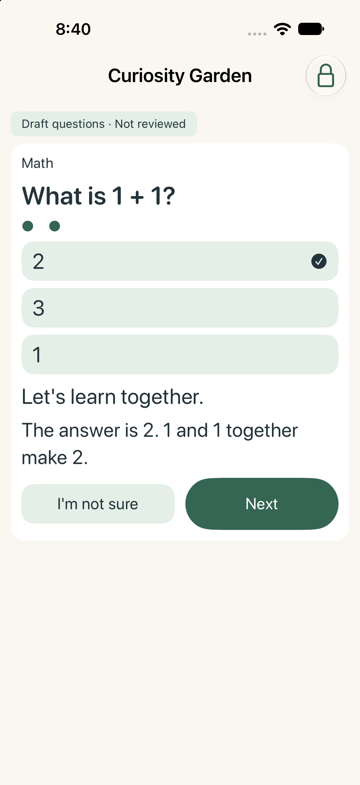
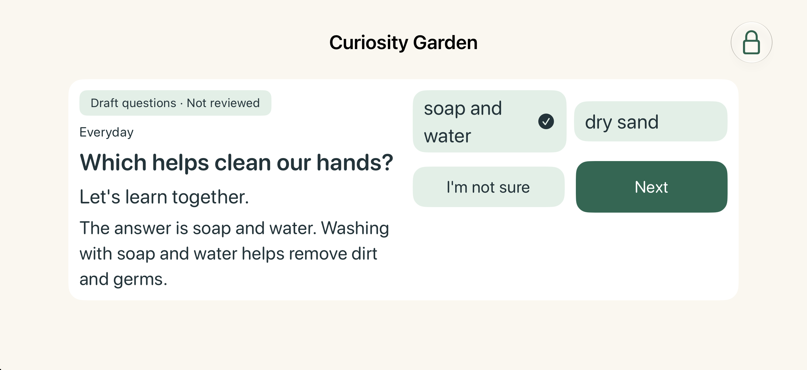
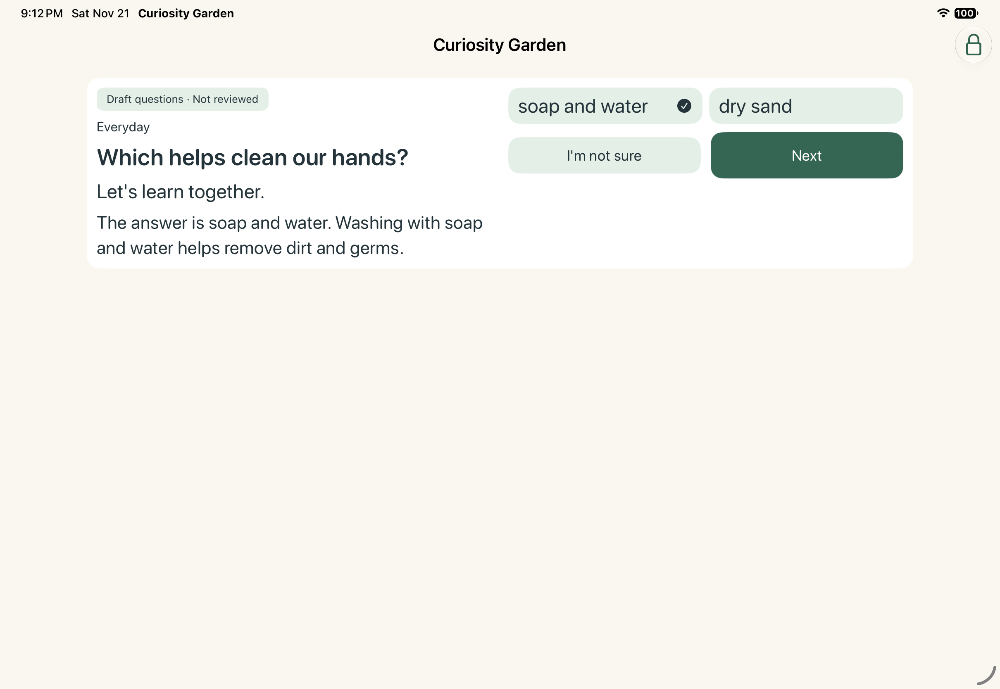
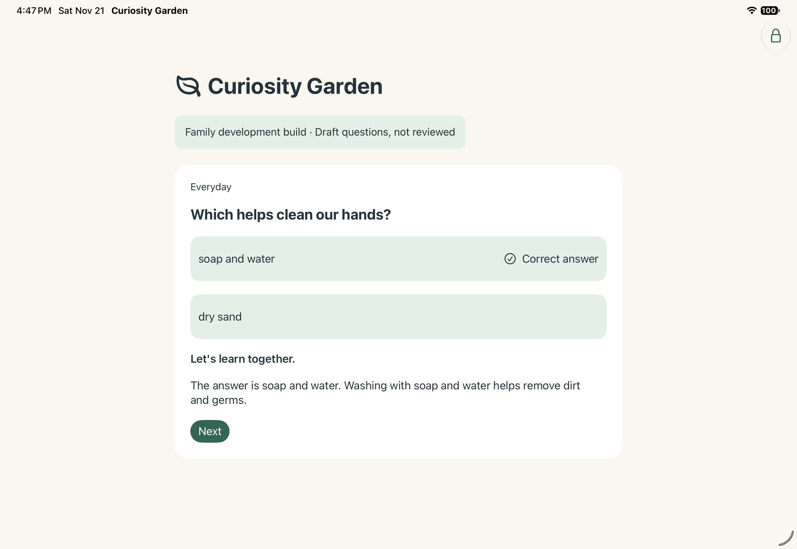

# Curiosity Garden

A calm, offline trivia app being designed for children in kindergarten through grade 5, on iPhone and iPad.

**Status: native SwiftUI development preview for iPhone and iPad (iOS/iPadOS 17+). The offline flow is implemented; the bundled questions are drafts and there is no reviewed question bank yet.** The project is public and open source under the MIT license. Maintainer builds are for family use, with no monetization and no maintainer App Store release planned.

## Screenshots

Real simulator captures using synthetic progress and **draft placeholder questions**. The iPhone captures use Extra large in-app text at the largest device text setting; the question, choices, explanation, I'm not sure, and Next fit together in portrait and landscape.









## Experience

- A parent selects the child's grade behind a separate parent PIN.
- Larger, capped reading text offers standard and rounded sans-serif options, saved in parent settings.
- The question screen keeps all choices, “I'm not sure,” and Next visible together.
- Mixed questions combine school subjects and general knowledge in an even balance.
- Missed questions return occasionally in later sessions alongside fresh questions.
- Each subject adapts independently across the K–5 range, with wording suited to the selected grade.
- Difficulty rises quietly after ten consecutive correct answers in a subject. Mistakes lead to easier questions in that subject.
- Rounds start at ten questions and may extend for difficulty calibration, to fifteen for K–2 or twenty for grades 3–5.
- Children can answer at their own pace, see short explanations, and finish with a learning recap without a score.
- Fixed session caps and thirty-minute breaks create clear stopping points.
- Parent reports include 7/30/90-day views, practice facts, recorded daily play time, and question-level history, protected by the parent PIN.
- Parents can change the PIN by providing the current PIN and a matching replacement.
- One child profile per device, local progress, offline content, and no cross-device synchronization.
- A minimal cream-and-sage interface, with readable dark text and occasional educational visuals.

The bundled bank now contains **1,440 original AI-assisted draft questions**: 40 per subject at each K–5 difficulty level. All remain unreviewed. [Review the 36 question packets](docs/QUESTION_BANK_REVIEW.md), including choices, draft keys, explanations, and primary-reference leads. Difficulty and reading targets need human review; this is not a certified curriculum. The screenshots above show earlier development placeholders. See [technical status](docs/TECH_STATUS.md) for completed code and remaining release checks.

## Project documents

- [Confirmed MVP requirements](docs/MVP_REQUIREMENTS.md)
- [Open decisions and implementation questions](docs/OPEN_DECISIONS.md)
- [Contribution guide](CONTRIBUTING.md)
- [MIT license](LICENSE)

## Building and testing

Open `CuriosityGarden.xcodeproj` and run the shared CuriosityGarden scheme on an iPhone/iPad simulator or your own signed device. Debug builds allow draft fixtures with a visible banner; Release builds accept reviewed content only and currently have no playable reviewed bank.

```sh
bash scripts/test_coverage.sh
python3 scripts/check_question_bank.py
xcodebuild -project CuriosityGarden.xcodeproj -scheme CuriosityGarden -configuration Debug -sdk iphonesimulator -destination 'generic/platform=iOS Simulator' CODE_SIGNING_ALLOWED=NO build
```

See [family installation](docs/FAMILY_BUILDS.md), [implementation choices](docs/IMPLEMENTATION_DECISIONS.md), [content review](docs/CONTENT_REVIEW.md), and [validation](docs/VALIDATION.md). CI requires 95% unit-test line coverage overall and for every production logic file, the question-bank audit, and Debug/Release iOS compilation on every push and pull request. The declarative SwiftUI view file is checked through UI validation rather than unit coverage. The pure Swift core has no external dependencies. Production content review and device accessibility validation remain release gates.

## Adapting and publishing

You are welcome to adapt Curiosity Garden, build your own version, and publish it, including on the App Store, under the [MIT license](LICENSE). The maintainer's family-build and no-monetization plan applies to the maintainer's distribution plans; it adds no restriction to the MIT license.

## Acknowledgment (optional)

If Curiosity Garden helps you build or publish something, I'd love a friendly acknowledgment and a link back to [this repository](https://github.com/sohambhattacharjee/curiosity-garden). A GitHub star is also appreciated if you find the project useful.

These requests are entirely optional and add no license conditions. Please preserve the copyright and license notices required by MIT.

## Contributing

Contributions to question quality, educational visuals, accessibility, and implementation are welcome as the project develops. Please read [CONTRIBUTING.md](CONTRIBUTING.md) and discuss substantial changes in an issue first. Keep real children's information and signing credentials outside the repository.

## License

[MIT](LICENSE). Preserve the applicable copyright and license notices when reusing the work. Any future third-party components or content must retain their required notices.
